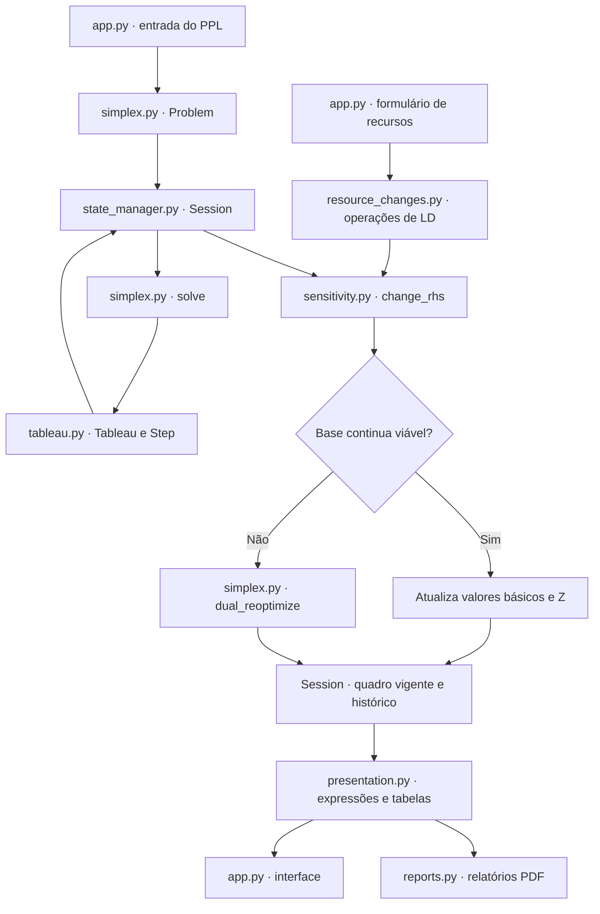

# Documentação completa do Simplex Tableau

## Objetivo e arquitetura

O programa resolve problemas de programação linear contínua com 2, 3 ou 4 variáveis não negativas. Além do ótimo, apresenta o primeiro quadro, os pivôs, o quadro ótimo, as condições de viabilidade e as alterações sucessivas de recursos. A interface segue a organização dos exercícios da NP2. A linha Z vem antes das variáveis básicas e o LD fica na última coluna.

A execução começa em `app.py` com `python -m streamlit run app.py`. Ao enviar o modelo, a interface cria um `Problem`, passa-o a `Session` e salva a sessão em memória em `st.session_state`. As interações seguintes reutilizam esse objeto. Cada exportação lê as mesmas estruturas de resultados que a interface.



| Arquivo | Responsabilidade |
| --- | --- |
| [app.py](app.py) | Entrada de dados, cinco abas, prévia, envio de propostas, restauração e download. |
| [simplex.py](simplex.py) | Modelo, construção do tableau, duas fases, primal e Dual. |
| [tableau.py](tableau.py) | Estrutura do quadro, quantidades algébricas e pivôs por operações de linha. |
| [sensitivity.py](sensitivity.py) | Preços-sombra, faixas, folgas e análise conjunta de alterações. |
| [state_manager.py](state_manager.py) | PPL inicial, solução vigente, histórico e restauração. |
| [resource_changes.py](resource_changes.py) | Aritmética e descrição de uma operação de recurso. |
| [presentation.py](presentation.py) | Nomes, números, fórmulas e desenvolvimento dos pivôs compartilhados pela tela e pelo relatório. |
| [reports.py](reports.py) | Composição de quatro relatórios com ReportLab. |
| [tests/test_simplex.py](tests/test_simplex.py) | Testes numéricos do solver, da sensibilidade e do estado. |
| [tests/test_presentation.py](tests/test_presentation.py) | Testes dos controles Streamlit, apresentação e exportações. |
| [requirements.txt](requirements.txt) | Dependências de execução. |
| [.streamlit/config.toml](.streamlit/config.toml) | Configuração do tema escuro. |
| [.gitignore](.gitignore) e [.gitattributes](.gitattributes) | Exclusão de caches e ambiente virtual, normalização do texto no Git. |
| [README.md](README.md) e [GUIA_APRESENTACAO.md](GUIA_APRESENTACAO.md) | Uso da aplicação e roteiro de demonstração. |

A documentação usa a notação `n` para o número de variáveis de decisão e `m` para o número de restrições. Vetores e matrizes do solver são arrays NumPy de ponto flutuante. Os índices Python começam em zero. Assim, `basis[0]` indica a coluna da variável básica da primeira linha, enquanto a interface apresenta R1 e Δ1.

## 1. Programação linear e Simplex

| Conceito | Significado e ocorrência no código |
| --- | --- |
| PPL | Otimizar uma expressão linear sujeita a restrições lineares, aqui com variáveis não negativas. `Problem` valida o modelo. |
| Função objetivo | `Z = cᵀx`. O vetor `Problem.c` guarda coeficientes como 40 e 30. |
| Variável de decisão | Quantidade que pode ser escolhida, como `x1` e `x2`. `Result.point(n)` devolve seus valores. |
| Restrição e LD | Uma linha de `a` e um sinal de `signs` comparam o consumo com o valor correspondente em `b`. LD é o lado direito. |
| Folga | Em `2x1 + x2 ≤ 100`, escreve-se `2x1 + x2 + f1 = 100`. A folga mede a capacidade não usada. `solve` adiciona a coluna unitária. |
| Excesso e artificial | Em uma linha ≥, subtrai-se uma variável de excesso. Quando essa coluna não fornece uma base inicial viável, adiciona-se uma artificial; igualdades também recebem artificial. A Fase 1 procura eliminá-las. |
| Básica e não básica | A base contém uma coluna por linha. No tableau canônico, essas colunas formam a identidade. Variáveis não básicas valem zero e as básicas assumem o LD do quadro. |
| Quadro | Apresentação de `B⁻¹A` e `B⁻¹b` com a linha objetivo. A matriz inclui as colunas de folga, excesso e artificiais aplicáveis. |
| Coluna pivô | Coluna que entra na base. No primal, `_run` filtra não básicas cujo custo reduzido interno é positivo. No modo do professor escolhe a de maior custo reduzido, e em Bland escolhe a de menor índice. |
| Linha pivô | Linha cuja variável sai. No primal, a menor razão `LD / coeficiente positivo` indica qual variável chega a zero primeiro. |
| Elemento pivô | Interseção da linha e da coluna escolhidas. `Tableau.pivot` divide a linha por esse elemento e zera a coluna nas demais. |
| Quadro ótimo | Base primal viável e sem custo reduzido interno positivo elegível. Na maximização da apostila a linha Z usa `Zj − Cj`, de modo que os coeficientes elegíveis para entrada seriam negativos. |

### `tableau.py` · representar e transformar um quadro

Importa `dataclass` e `replace` de `dataclasses`, além de NumPy. O módulo declara `TOL = 1e-9`, usado pelo solver para comparações numéricas. Esse valor é distinto da tolerância de exibição.

**`Tableau`** guarda `names` (nomes em ordem de coluna), `coefficients` (matriz), `rhs` (vetor), `inverse` (transformações de linha), `basis` (índices por linha) e `costs` (coeficientes da função objetivo interna). A dataclass congelada impede a troca direta dos atributos. A implementação cria arrays novos para os pivôs, pois congelar a dataclass não congela o conteúdo de um array.

| Membro | Entrada e retorno | Operação, uso e falhas |
| --- | --- | --- |
| `cb` | Instância → vetor de comprimento `m` | Seleciona `costs` pelos índices de `basis`. Alimenta `zj`, `z` e `prices`. Nos dois últimos básicos do exemplo, retorna `[40, 30]`. A estrutura pressupõe índices válidos. |
| `zj` | Instância → vetor por coluna | Calcula `cb @ coefficients`. O operador `@` faz multiplicação matricial. No exemplo, os valores das folgas no ótimo são 10 e 20. |
| `reduced` | Instância → vetor por coluna | Calcula `costs - zj`. A ordem dos sinais é invertida ao desenhar a linha Z. A primeira entrada de `reduced` no quadro inicial vale +40. |
| `z` | Instância → `float` | Produto `cb @ rhs`. Na Fase 1, representa o negativo da soma das artificiais; no objetivo de minimização interno representa `−Z`. |
| `pivot(row, col)` | Dois índices `int` → `Tableau` novo | Usa Gauss–Jordan na linha escolhida, no LD e nas colunas auxiliares. O solver fornece pivô não nulo. Um índice fora do quadro ou um pivô nulo viola essa precondição. |

O bloco principal é:

```python
joined = np.column_stack((self.coefficients, self.rhs, self.inverse))
factors = self.coefficients[:, col].copy()
pivot_row = joined[row] / factors[row]
joined -= factors[:, None] * pivot_row
joined[row] = pivot_row
joined[:, col] = 0
joined[row, col] = 1
```

`column_stack` coloca lado a lado os coeficientes, o LD e a matriz auxiliar. `[:, col]` seleciona a coluna inteira. A cópia retém os coeficientes que devem multiplicar a linha normalizada. `[:, None]` transforma o vetor em uma coluna, permitindo que o broadcasting multiplique cada linha pelo seu fator. A subtração elimina a coluna pivô nas outras linhas. A linha pivô é reatribuída porque a operação vetorizada também a modificou. A coluna é fixada em zero e um para manter a representação canônica. Finalmente, `replace` cria o novo quadro com a variável entrante em `basis[row]`. No primeiro pivô do exemplo, dividir `[2, 1, 1, 0, 100]` por 2 produz `[1, 0,5, 0,5, 0, 50]`.

**`Step`** guarda `phase`, `tableau`, índices opcionais `row` e `column`, `ratios` e `note`. O quadro registrado é o anterior ao pivô descrito pelo próprio objeto. Um `Step` de parada tem linha e coluna ausentes. A tela usa os dados do passo anterior ao explicar como chegou ao quadro seguinte.

### `simplex.py` · preparar, encontrar uma base e resolver

Importa NumPy, os utilitários de dataclass e `Step`, `Tableau`, `TOL`. `Problem` e `Result` são dataclasses congeladas.

| Membro | Entrada e retorno | Processamento, uso e exemplo |
| --- | --- | --- |
| `Problem(c, a, signs, b, sense)` e `__post_init__()` | Vetor, matriz, sequência de sinais, vetor e `str` → modelo | Converte `c`, `a` e `b` para arrays finitos, copia e marca como somente leitura. Aceita `max` e `min`, sinais ≤, ≥ e =, e dimensões coerentes. Dados inválidos provocam `ValueError`. |
| `Problem.direction` | Modelo → `int` | Retorna +1 para maximização e −1 para minimização. O solver opera como maximizador e reescala o objetivo na exibição. |
| `Result` | Estado, quadro, passos, linhas fixas, matriz → registro | `status` é `ótimo`, `inviável`, `ilimitado` ou `limite numérico`. `matrix` guarda as colunas do modelo estendido na convenção original quando há uma base de Fase 2. |
| `Result.base_matrix` | Resultado com matriz → `ndarray` | Seleciona da matriz original as colunas de `basis` na ordem das linhas do quadro. Para a base `(x1, x2)`, fornece `[[2,1],[1,1]]`. Requer uma matriz disponível. |
| `Result.basic_names` e `nonbasic_names` | Resultado → duas tuplas | Mapeiam índices a nomes ou excluem as colunas da base. No exemplo final são `('x1','x2')` e `('f1','f2')`. |
| `Result.point(n)` | `int` → vetor de comprimento `n` | Inicializa zero e preenche com o LD as posições das básicas de decisão. Preserva a precisão do LD no vetor devolvido. A apresentação decide como exibir resíduos próximos de zero. |
| `solve(problem, *, pivot_rule="bland")` | `Problem` → `Result` | Normaliza o LD, agrega auxiliares, executa a Fase 1 quando necessário e resolve a Fase 2. É chamado ao criar a sessão. Para os LDs 100 e 80 devolve `Z=2600`. |
| `_run(tableau, phase, dual=False, fixed=(), *, pivot_rule="bland")` | Quadro, nome da fase, modo booleano e índices fixos → `Result` | Motor dos pivôs. Registra as razões, aplica `pivot` e produz status. Uma repetição no modo do professor aciona Bland. O limite de 10.000 iterações, uma base repetida em Bland ou dados não finitos terminam com estado numérico. |
| `dual_reoptimize(reference, tableau)` | `Result` ótimo e `Tableau` com novo LD → `Result` | Verifica as equações dependentes e chama `_run` em modo dual. Transporta a matriz e as linhas fixas. Exemplo com LDs 1000 e 80 obtém `Z=3200`. |

O bloco abaixo prepara as coordenadas para os pivôs:

```python
normal = np.array(columns).T
original_matrix = signs[:, None] * normal
# A identidade com os sinais das linhas acompanha os pivôs até virar B⁻¹.
tableau = Tableau(tuple(names), normal, abs(problem.b), np.diag(signs),
                  tuple(basis), np.zeros(len(names)))
```

O vetor local `signs` contém −1 quando o LD original é negativo e +1 nos demais casos. O laço anterior multiplica a linha negativa por −1, inverte ≤ e ≥ e adiciona as respectivas colunas unitárias ou negativas. `.T` transforma a coleção de colunas em matriz com uma restrição por linha. Multiplicar novamente pelos sinais fornece `original_matrix` nas coordenadas do problema original. `np.diag(signs)` preserva essa ligação no lado auxiliar do tableau, o que torna `B⁻¹Δb` válido para o `Δb` informado pelo usuário. Matematicamente, a aplicação obtém a inversa pelas operações de linha, sem chamar `np.linalg.inv`.

**Fase 1.** Se existem artificiais, `costs[artificial] = -1` define o objetivo auxiliar de maximizar o negativo da soma. Se o máximo fica abaixo de `-TOL`, alguma artificial precisa ser positiva e o PPL é inviável. As artificiais básicas ainda presentes no ótimo auxiliar valem zero dentro da tolerância. O laço de transição tenta trocá-las por colunas reais não básicas. Quando nenhuma é elegível, a linha é dependente e sua artificial funciona como marcador fixo em zero. O vetor `retained` guarda os índices sobreviventes e traduz os índices antigos para a Fase 2. Os custos das variáveis de decisão passam a ser `problem.direction * problem.c`.

**Primal.** O código relevante de `_run` é:

```python
columns = [j for j in nonbasic if reduced[j] > TOL]
if not columns:
    status = "ótimo"
    break
column = (min(columns, key=lambda j: (-reduced[j], j))
          if pivot_rule == "professor" else min(columns))
ratios = [(i, max(0, b) / tableau.coefficients[i, column])
          for i, b in enumerate(tableau.rhs)
          if tableau.coefficients[i, column] > TOL]
if not ratios:
    status = "ilimitado"
    break
row, _ = min(ratios, key=lambda item: (
    item[1], item[0] if pivot_rule == "professor" else tableau.basis[item[0]],
))
```

A compreensão de lista filtra candidatas. `min(columns)` escolhe por ordem das variáveis quando Bland está ativo. A interface usa por padrão o maior custo reduzido interno, que aparece como o coeficiente mais negativo na linha Z de maximização. Se uma base se repete, o critério do professor cede a Bland. `enumerate` fornece índice e LD para cada linha. O `max(0, b)` evita que pequenos resíduos negativos produzam razão negativa. O `lambda` ordena primeiro pela menor razão e desempata pela ordem da linha no modelo do professor ou pelo índice da variável básica no modo Bland. A notação `row, _` descarta o valor da razão escolhida, embora o conjunto de razões seja preservado em `Step`. Se uma variável pode melhorar Z e não há linha que limite seu crescimento, o problema é ilimitado.

## 2. Sensibilidade e Simplex Dual

A análise de sensibilidade deste projeto muda apenas `b`. Mantidos `A`, `c` e a base, os custos reduzidos independem de `b`. Portanto, se os valores básicos continuarem viáveis, a base mantém a otimalidade. A atualização é:

```text
Δb = b_proposto − b_atual
xB_proposto = xB_atual + B⁻¹Δb
yᵀ = CbᵀB⁻¹
ZNOVO = ZANTERIOR + yᵀΔb
```

A fórmula do preço-sombra segue de `Z = CbᵀxB`. O preço-sombra mede o efeito marginal de uma unidade de LD dentro da região em que a base se mantém. Em uma coluna de folga com +1 no modelo original, a linha Z do quadro ótimo fornece diretamente esse preço, pois o custo da folga é zero. Se a coluna do modelo original é −1, o coeficiente exibido tem sinal oposto. Igualdades não têm folga para ler e a aplicação usa o produto matricial. `Problem.direction` devolve o resultado à escala original de minimização ou maximização.

### `sensitivity.py` · calcular e registrar uma proposta

Importa NumPy, `dataclass`, `replace`, `Result`, `dual_reoptimize` e `TOL`. A dataclass **`Change`** registra `old_rhs`, `new_rhs`, `previous`, `result`, preços anteriores em `shadow`, valores básicos ensaiados em `trial`, nomes de condições violadas em `violations`, objetivos anterior e posterior, `method`, `previous_ranges` e tuplas `operations`. Seu atributo calculado `delta` subtrai os vetores de LD. O registro pode representar uma tentativa inviável. Nessa situação, `result` é o diagnóstico da proposta e `new_z` é `None`.

| Função | Entradas e retorno | Como funciona |
| --- | --- | --- |
| `prices(problem, result)` | `Problem` e `Result` com base → vetor `float` | Multiplica `t.cb @ t.inverse` por `direction`. Com `[40,30]` e `[[1,-1],[-1,2]]`, retorna `[10,20]`. A matriz deve corresponder ao quadro. |
| `ranges(result, rhs)` | `Result` ótimo e vetor de LD → matriz `m × 2` | Varre uma coluna de `B⁻¹` por vez. Para `xᵢ + aᵢΔ ≥ 0`, toma `−xᵢ/aᵢ` como limite inferior se `aᵢ>0` ou superior se `aᵢ<0`. Fatores desprezíveis não restringem o intervalo. Linha fixa relevante impõe Δ zero. Soma o LD atual aos limites. Ausência de limite produz infinito. |
| `slacks(problem, result, rhs)` | Modelo, quadro e vetor de LD → vetor | Calcula `rhs - a @ point(n)` e troca o sinal das linhas ≥ para mostrar excesso positivo. Igualdades exibem resíduo. No ótimo do exemplo, ambas são zero. |
| `Change.delta` | Registro → vetor | Calcula a variação na ordem original. De `[100,80]` para `[110,80]`, retorna `[10,0]`. |
| `change_rhs(problem, reference, old_rhs, new_rhs, *, restored=None, operations=())` | Modelo, quadro vigente, vetores, resultado salvo opcional e metadados → `Change` | Valida forma e finitude, ensaia a base, escolhe atualização direta, Dual ou restauração e registra as condições. LD malformado gera `ValueError`. Estouro em Δ, nos básicos ou no Z confirmado gera `ArithmeticError`. |

O trecho central é:

```python
with np.errstate(over="ignore", invalid="ignore"):
    delta = new_rhs - old_rhs
    trial = t.rhs + t.inverse @ delta
if not np.isfinite(trial).all() or not np.isfinite(delta).all():
    raise ArithmeticError("A variação ultrapassou a capacidade de cálculo. Revise a escala dos LDs.")
candidate = replace(t, rhs=trial)
```

`np.errstate` permite tratar a falha com uma mensagem da aplicação. `np.isfinite(...).all()` exige que todos os valores calculados sejam finitos. `replace` preserva os coeficientes e a base e troca o vetor básico. A compreensão que monta `violations` procura valores abaixo de `-TOL` e linhas fixas acima de `TOL`. Uma linha fixa deve continuar em zero, então falha para desvios relevantes nos dois sentidos.

Com `Δb=(10,0)`, o vetor passa de `(20,60)` para `(30,50)`, sem pivô. As faixas individuais iniciais são **R1 de 80 a 160** e **R2 de 50 a 100**. Em R1 pode-se diminuir 20 ou aumentar 60. Em R2 pode-se diminuir 30 ou aumentar 20. Cada faixa pressupõe que os outros LDs continuam fixos. Para alterações combinadas, a multiplicação usa todas as componentes simultaneamente. Por exemplo, `Δb=(20,-8)` dá `xB=(48,24)` e `ZNOVO=2640`.

### Como o Dual aproveita a base

Quando um LD modificado torna alguma variável básica negativa, o quadro ainda possui os mesmos custos reduzidos. O Simplex Dual explora essa viabilidade dual e recupera a viabilidade primal por pivôs, partindo de `candidate`. `dual_reoptimize` rejeita primeiro uma violação nas equações dependentes fixas.

```python
row = min(rows, key=lambda i: tableau.basis[i])
ratios = [(j, max(0, -reduced[j]) / -tableau.coefficients[row, j])
          for j in nonbasic if tableau.coefficients[row, j] < -TOL]
if not ratios:
    status = "inviável"
    break
column, _ = min(ratios, key=lambda item: (item[1], item[0]))
```

`rows` contém as linhas de LD negativo elegíveis. O índice de variável básica desempata a escolha. Só entram candidatas com coeficiente negativo na linha de saída. A menor razão preserva a condição dual; o índice da coluna resolve empate. `Tableau.pivot` normaliza o pivô negativo e atualiza as outras linhas pela mesma operação de Gauss–Jordan. Quando os LDs elegíveis ficam não negativos, tem-se um novo ótimo. Se uma linha negativa não admite coluna de entrada, o problema **modificado** fica inviável e a última solução ótima continua vigente.

Com R1 alterado de 100 para 1000 e R2 mantido em 80, o quadro antigo ensaia `x1=920`, `x2=-840`. A segunda condição falha. Na linha de `x2`, F1 tem coeficiente −1 e razão `(-10)/(-1)=10`. Entra F1, sai x2, e o ótimo fica em `(80,0)` com `Z=3200`. Os preços-sombra passam a `(0,40)`. O lucro calculado com os preços da base anterior não é usado nessa proposta.

## 3. Operações, estrutura de estado e Streamlit

### `resource_changes.py` · interpretar os controles de recursos

Importa `isfinite` do módulo padrão `math`. Os operadores recebem o LD vigente na escala do PPL. Uma operação em `operations` é uma tupla de quatro itens `(índice int, operação str, unidade str, valor float)`.

| Função | Contrato e exemplo |
| --- | --- |
| `resource_rhs(current, operation, unit, value)` | Recebe dois valores numéricos e duas strings. Retorna o novo LD. Em R1 de 100, `Aumentar`, `%`, 10 dá 110, `Diminuir`, `unidades`, 5 dá 95 e `Dobrar` dá 200. `Multiplicar` aceita fator não negativo. Definir ou restaurar uma restrição devolve o valor-alvo fornecido. Entradas não finitas e fatores incompatíveis com aumentar ou diminuir geram `ValueError`. |
| `relative_percentage(current, delta)` | Dois números → taxa percentual ou `None`. De 80 com Δ de −8 fornece −10. LD anterior zero ou percentual não representável fica sem taxa. |
| `operation_description(operation, unit, value, fmt)` | Strings, número e formatador → par de strings com ação e quantidade. Alimenta o histórico e a descrição do PDF. `Dobrar` produz `('Dobrar','2 vezes')`. |
| `operation_calculation(old, operation, unit, value, fmt)` | LD anterior, strings da ação, valor e formatador → conta textual do Δ. Para mais 10% sobre 100, gera `(100) × 10 / 100`. Pressupõe metadados de uma operação validada. |

A condição percentual usa `current + direction * current * (value / 100)`. O LD corrente entra com seu sinal. Em unidades, a variação é a quantidade multiplicada por +1 ou −1. Em fator, o produto `current * value` é o próprio novo LD. O sinal do LD negativo pode inverter a interpretação intuitiva de “aumentar” em porcentagem; nesse cenário, o LD direto permite indicar o alvo sem ambiguidade.

### `state_manager.py` · preservar o quadro ótimo

Importa NumPy para os tipos de vetor, `dataclass` e `field`, além de `solve`, `Problem`, `Result`, `Change` e as funções de sensibilidade. A classe mutável **`Session`** guarda `problem` e `original`, `current` e `rhs`, estatísticas iniciais e `history`. `field(default_factory=list)` cria uma lista independente para cada sessão.

| Método | Entrada, retorno e falhas |
| --- | --- |
| `__post_init__()` | Executado ao construir `Session(problem)`. Chama `solve` uma vez, guarda o resultado inicial e inicializa os LDs e, se houve ótimo, os preços, as faixas e as folgas originais. Não devolve valor diretamente. |
| `apply(new_rhs, *, operations=())` | Vetor proposto e metadados opcionais → `Change`. Exige ótimo vigente. Registra propostas matematicamente analisadas. `ValueError` e `ArithmeticError` propagam para a interface antes de alterar o estado. |
| `restore(number=None)` | Um número de histórico começando em 1 ou `None` para o original → `Change` de restauração. Seleciona vetor e quadro já salvos, registra a restauração e os reativa sem pivô. Índice inexistente ou estado sem ótimo gera `ValueError`. |

O trecho de compromisso da sessão é:

```python
change = change_rhs(self.problem, self.current, self.rhs, new_rhs, operations=operations)
self.history.append(change)
if change.result.status == "ótimo":
    self.current = change.result
    self.rhs = change.new_rhs
return change
```

Sempre se usa `self.current` e `self.rhs`. Uma proposta inviável entra no histórico e mantém a referência vigente. Quando há ótimo, `current` passa a conter o quadro com os novos valores básicos. O Z é calculado diretamente para o registro e fica disponível pelo quadro. As folgas exibidas em sensibilidade são derivadas do novo ponto e do novo LD por `slacks`. As faixas são relativas à referência escolhida na aba; depois de pivôs, também variam os preços-sombra.

### `app.py` · renderização e envio dos campos

Importa pandas para tabelas, Streamlit para interface, as funções de apresentação, relatório, operações e sensibilidade, `Problem`, `Session` e `TOL`. A aba **Entrada do PPL** usa seletores de dimensão e um formulário com coeficientes e sinais. Enviar cria nova sessão e incrementa `model_version`. O script controla as abas com `st.tabs` e pode parar com `st.stop` quando ainda não há modelo ou o modelo não possui quadro ótimo.

| Função | Entrada e retorno | Uso e exemplo |
| --- | --- | --- |
| `fmt(value)` | Número, string ou vazio → string | Repassa o valor e o controle `digits` a `format_number`. Com quatro casas, 10.5 aparece como `10,5`. O mesmo callable vai ao relatório. |
| `grid(rows, columns=None, index=None)` | Linhas iteráveis e rótulos opcionais → efeito visual | Cria DataFrame e aplica `frame.style.format(fmt)` antes de chamar `st.dataframe`. Os valores de origem continuam numéricos. Um cabeçalho incompatível com a largura é erro de programação. |
| `point(problem, result, z)` | Modelo, resultado, escalar → efeito visual | Renderiza métrica de Z ótimo e as primeiras `n` variáveis por `point(n)`. |
| `show_tableau(tableau, objective_sign=1)` | Quadro e sinal inteiro → tabela | Combina `manual_rows` e `manual_columns`. Para o exemplo, cabeçalho `VB, X1, X2, F1, F2, LD`. |
| `show_steps(steps, direction, optimal=False, *, context="original")` | Sequência de `Step`, sinal, booleano e chave textual → blocos | Abre um expansor por quadro, identifica o final e permite marcar a caixa de cálculo do pivô anterior. `context` diferencia controles da resolução, da alteração recente e da entrada do histórico. |
| `show_conditions(result, change=None)` | `Result` e `Change` opcional → linhas | Exibe a inequação ou igualdade e, quando há tentativa, a substituição avaliada. Usa texto e cor para OK ou não viável. |
| `show_change(problem, change, *, context)` | `Problem`, `Change`, chave textual → blocos | Renderiza proposta, condições, conclusão, passos do Dual, cálculos de Z e detalhe opcional das matrizes. Se o resultado ficou inviável ou numérico, informa que o último ótimo segue vigente. |
| `resource_proposal(session, operations)` | `Session` e sequência de operações → vetor | Copia o LD atual e altera os índices escolhidos via `resource_rhs`. De `[100,80]` com 20% e −10%, retorna `[120,72]`. Erros de parâmetros impedem a aplicação. |
| `show_status(status, *, modified=False)` | Status textual e booleano → mensagem | Distingue inviabilidade, ilimitabilidade e falha numérica, com contexto original ou modificado. |

**Sincronização.** Streamlit executa o script de cima para baixo a cada interação enviada. `st.session_state["session"]` sobrevive a esses reruns. A seleção das restrições acontece antes da edição. Operação, unidade e valor ficam juntos em `st.form` para que o navegador envie todos os campos no mesmo clique. A prévia não chama `Session.apply`; o cálculo sempre reconstrói a proposta com os valores do envio mais recente.

```python
proposal = resource_proposal(session, operations)
if calculate:
    session.apply(proposal, operations=operations)
    st.rerun()
st.session_state["resource_preview"] = (preview_key, tuple(operations), proposal)
```

`st.rerun()` interrompe a execução corrente e redesenha a interface com a nova referência. O código após esse ramo só grava a prévia quando o botão de prévia foi clicado. A chave usa a versão do modelo, o comprimento do histórico e a seleção. Isso evita mostrar prévias calculadas sobre LDs superados. Os controles numéricos e de operação mantêm chaves por modelo e por restrição, o que conserva os valores confirmados de uma interação para outra. Enquanto se digita um valor, o navegador não envia o rascunho ao servidor; o título da prévia deixa explícito que ela representa o último envio e ainda não foi aplicada.

As outras abas leem a mesma sessão. A análise pode escolher o quadro inicial ou o vigente. Histórico mostra tipo de operação, entrada, percentual efetivo, Δ, LD, preços usados, viabilidade, método e Z. A consulta de um item expõe o quadro associado e as contas. A exportação guarda temporariamente os bytes junto de uma chave com modelo, histórico, seção, casas decimais e referência de sensibilidade para oferecer apenas a versão correspondente à tela atual.

## 4. Apresentação e PDF

### `presentation.py` · produzir a resolução manual

Importa `isinf`, `isnan`, `Real`, as funções textuais de operações e `TOL`. Define `DISPLAY_TOL = 1e-8` para exibição. O formatador `fmt` que as funções recebem é um callable de valor para string. O código interno permanece em ponto flutuante; a retenção de casas, vírgula e remoção de zeros acontecem só na montagem da saída.

| Função | Entrada e saída | Uso e exemplo |
| --- | --- | --- |
| `format_number(value, digits=4)` | Valor e `int` → string | Arrays permanecem fora dessa função até que uma célula seja selecionada. Preserva texto, mostra `—` para ausência/NaN e ∞ para limite infinito. Resíduos em módulo até `DISPLAY_TOL` aparecem como zero. Com quatro casas, `1/3` aparece como `0,3333`. |
| `manual_columns(tableau)` | `Tableau` → lista textual | Cabeçalhos VB, nomes em maiúsculas, LD. A ordem segue os índices usados nos cálculos. |
| `manual_rows(tableau, objective_sign=1)` | Quadro e fator → iterador de linhas mistas | A primeira linha tem `-objective_sign * reduced` e `objective_sign * z`. As outras têm nome da básica, coeficientes e LD. No ótimo do exemplo, a linha Z é `[Z,0,0,10,20,2600]`. |
| `delta_expression(constant, coefficients, fmt, delta=None, *, objective=False)` | Escalar, vetor, formatador, vetor opcional e booleano → string | Percorre os coeficientes e omite termos exatamente nulos. Gera Δ simbólico ou coloca a variação entre parênteses. `objective=True` explicita coeficientes unitários do objetivo. |
| `objective_scale(step, direction)` | `Step` e sinal → sinal (`int`) | Usa +1 na Fase 1 e transição porque o custo é auxiliar. Nos outros passos, usa o sentido original. |
| `pivot_lines(step, direction, fmt)` | Passo, direção e formatador → iterador textual | Apresenta seleção, razões registradas, normalização e atualização numérica de todas as linhas, inclusive Z. O helper local `vector(values)` formata os coeficientes e LD na ordem do quadro. Usa o pivô registrado e só produz texto quando existe uma linha pivô. |
| `conditions(result, fmt, change=None)` | Resultado, formatador e alteração opcional → pares de texto e estado | Monta uma condição por linha de `inverse`. Usa igualdade em linhas fixas, ≥ nas demais. Se há tentativa, reaproveita `trial` e `violations` para calcular o rótulo, sem inferir a viabilidade de números arredondados. |
| `objective_lines(change, fmt)` | `Change` e formatador → iterador textual | Quando o método é preço-sombra, gera a fórmula geral, os coeficientes, a substituição e os produtos. Exemplo `2600 + 200 − 160`. Em Dual ou restauração, mostra o Z do quadro encontrado ou salvo. |
| `objective_expression(coefficients, fmt)` | Sequência numérica e formatador → string | Formata a função objetivo e o lado esquerdo das restrições. Remove o sinal + inicial e devolve `0` quando não há termos. |
| `proposal_lines(change, fmt)` | Registro e formatador → iterador textual | Recupera operação por índice, mostra LD anterior, conta do Δ e LD proposto. Se não há metadados, usa `novo − anterior`, como na restauração. |

As rotinas de apresentação pressupõem os tipos produzidos pelos módulos anteriores. Dados incompatíveis, como um vetor Δ com dimensão errada, são erro de integração. A exibição de zero em poucas casas pode coexistir com uma condição marcada como não viável; a decisão usa os valores originais. Aumentar a precisão ajuda a mostrar resíduos maiores que a tolerância visual.

### `reports.py` · compor os resultados em PDF

Importa `BytesIO`, `escape`, componentes ReportLab, funções da apresentação e `prices` e `ranges`. O dicionário `REPORTS` fornece identificadores e títulos. **`report_pdf(session, section, fmt, *, sensitivity_reference="Atual")`** recebe uma `Session`, a chave textual da seção, o mesmo formatador da tela e a referência escolhida no relatório de sensibilidade. Retorna `bytes` do documento, sem escrever arquivos no servidor. Chave desconhecida gera `KeyError`; o seletor da interface oferece apenas valores desse dicionário.

Os helpers locais escrevem em `content`, uma sequência de elementos ReportLab:

| Helper | Entrada e efeito |
| --- | --- |
| `text(value, kind="BodyText")` | Escapa texto e o transforma em `Paragraph` com o estilo solicitado. |
| `tableau(t, scale)` | Gera tabelas das linhas do quadro. Divide muitas colunas em grupos de dez e repete VB e LD para consulta. |
| `steps(result)` | Percorre `result.steps`, mostra títulos, notas, quadros e os cálculos registrados. |
| `point(result)` | Renderiza as variáveis de decisão do ótimo. |
| `shadow(result)` | Calcula e mostra cada preço-sombra na escala do modelo. |

A resolução completa inclui o PPL inicial, quadros, ótimo inicial, sensibilidade vigente e histórico. Os relatórios especializados reutilizam as mesmas funções. As contas de alteração, inclusive o estado das condições, são obtidas do mesmo `Change` apresentado na interface. A exportação usa a precisão atualmente selecionada, portanto não muda os valores internos da sessão.

## 5. Exemplo comentado do início ao fim

Cadastre **Maximizar**, duas variáveis, duas restrições e input `c=[40,30]`, `a=[[2,1],[1,1]]`, `signs=['≤','≤']`, `b=[100,80]`. `Problem` valida as dimensões e `Session.__post_init__` chama `solve`. As duas folgas já dão uma base viável, então o primeiro quadro é da Fase 2.

| VB | X1 | X2 | F1 | F2 | LD |
| --- | ---: | ---: | ---: | ---: | ---: |
| Z | −40 | −30 | 0 | 0 | 0 |
| F1 | 2 | 1 | 1 | 0 | 100 |
| F2 | 1 | 1 | 0 | 1 | 80 |

Entra X1 pelo coeficiente −40 na linha Z. As razões são 100/2 = 50 e 80/1 = 80. Sai F1. Divide-se a primeira restrição por 2, subtrai-se sua linha normalizada da segunda e soma-se 40 vezes essa linha à linha Z.

| VB | X1 | X2 | F1 | F2 | LD |
| --- | ---: | ---: | ---: | ---: | ---: |
| Z | 0 | −10 | 20 | 0 | 2000 |
| X1 | 1 | 0,5 | 0,5 | 0 | 50 |
| F2 | 0 | 0,5 | −0,5 | 1 | 30 |

Entra X2. As razões 50/0,5 = 100 e 30/0,5 = 60 fazem F2 sair. Divide-se a segunda restrição por 0,5, subtrai-se 0,5 vez a linha normalizada da primeira e soma-se 10 vezes essa linha a Z.

| VB | X1 | X2 | F1 | F2 | LD |
| --- | ---: | ---: | ---: | ---: | ---: |
| Z | 0 | 0 | 10 | 20 | 2600 |
| X1 | 1 | 0 | 1 | −1 | 20 |
| X2 | 0 | 1 | −1 | 2 | 60 |

`_run` identifica o ótimo. `Result.point` fornece `(20,60)`. `prices` usa `[40,30] @ [[1,-1],[-1,2]]`, obtendo 10 e 20. São os coeficientes de F1 e F2 em Z. `conditions` lê as linhas da inversa e gera `20 + Δ1 − Δ2 ≥ 0` e `60 − Δ1 + 2Δ2 ≥ 0`.

Na aba **Alterações do LD**, selecione R1, escolha **Aumentar**, **%** e **10**. `resource_proposal` usa `resource_rhs` para converter a ação em LD 110. **Atualizar prévia** inspeciona esse valor sem alterar a sessão. **Calcular novo Z** envia o formulário, monta o vetor `[110,80]` e chama `Session.apply`. `change_rhs` substitui Δ nas duas linhas. Os resultados `20 + 10 − 0 = 30` e `60 − 10 + 2(0) = 50` são viáveis. A conta é `2600 + 10(10) + 20(0) = 2700`. O histórico guarda o quadro antes e depois da mudança e o método **Preço-sombra**.

| Ação seguinte | LD vigente após aceitar | Básicas do mesmo quadro | Z |
| --- | --- | --- | ---: |
| R1 +10% partindo do original | (110, 80) | (30, 50) | 2700 |
| R2 +10% sobre 80 | (110, 88) | (22, 66) | 2860 |
| R1 −5 unidades sobre 110 | (105, 88) | (17, 71) | 2810 |

Cada linha testa novamente as condições, recalculadas a partir do último quadro confirmado. A operação seguinte parte dos LDs vigentes mesmo quando o usuário mudou de aba.

## 6. Testes, referências e limites

`tests/test_simplex.py` importa `unittest`, `patch`, NumPy e os módulos do solver. `example()` cria o PPL de teste com objetivo `(3,2)`. `SimplexTests` compara tableau, ponto, preços, faixas, minimização em duas fases, sinal de LD negativo, inviabilidade, ilimitabilidade e degenerescência. `SensitivityTests` verifica alterações simultâneas e sucessivas, tentativa inviável, restauração indireta da referência após tentativa falha, linhas dependentes e proteção contra estouro no objetivo. O teste de reutilização usa `patch` para transformar chamadas ao solver, ao motor de pivôs ou ao pivoteamento em falha imediata.

`tests/test_presentation.py` importa `Path`, `unittest`, `patch`, NumPy e `AppTest`, além das funções reais de apresentação, exportação e operações. `render(session)` inicia a interface simulada com uma sessão conhecida. `displayed_text(app, tab)` reúne os textos da aba indicada. `ManualPresentationTests` aciona formulários, inspeciona contas e confirma os exemplos da NP2, o Dual, as alterações em lote, a restauração e a saída PDF. `ResourceChangeTests` verifica operações e formatação isoladamente. Os testes usam `assert` e métodos de `unittest` para detectar divergências entre números, método e texto apresentado. Execute com `python -m unittest discover -s tests -v`.

A convenção visual foi conferida em *Exercícios_NP2_Resolução.pdf*. *Exercícios_NP2.pdf* e *Exercícios_Simplex.pdf* fornecem os enunciados utilizados como referência. Com o critério padrão da interface, os testes reproduzem os pivôs e as bases dos dois exercícios resolvidos da NP2. A opção Bland pode levar a outra base em casos degenerados. No exercício 1, o item C reprova a base original e o Dual pode continuar. O item D mantém a base e dá 15.750. No exercício 2, o ponto inicial é (10/3, 1/3), com lucro original 80 e lucro alterado 64 no item C.

A aplicação trata apenas variáveis contínuas e não negativas, e a sensibilidade interativa altera os LDs. Os cálculos usam ponto flutuante e tolerâncias fixas, então coeficientes com escalas extremas ou modelos mal condicionados podem exigir reescala. O histórico vive na sessão Streamlit e pode ser exportado; não há banco de dados para recuperar sessões encerradas.
